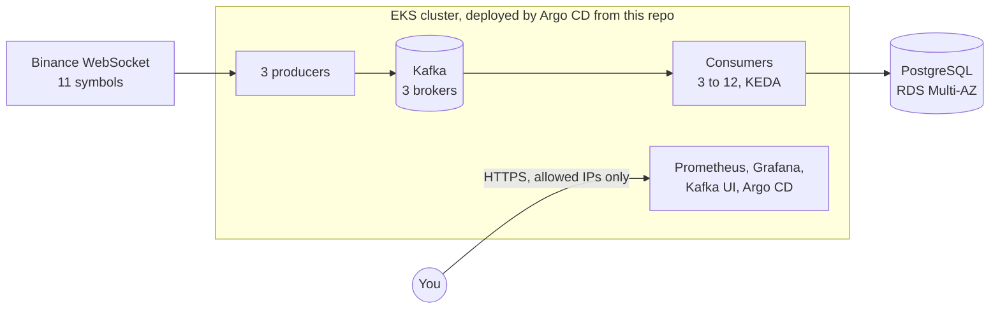

# Binance trades → Kafka → PostgreSQL on EKS

## How it fits together



Terraform creates the AWS side (network, EKS, RDS, secrets) and installs Argo CD. Argo CD then deploys everything inside the cluster straight from this repository.

## What problem it solves

Every trade Binance publishes for 11 symbols should end up in Postgres exactly once, within 2 seconds, and keep doing so when things break: a pod dies, a Kafka broker restarts, a node is drained. And you should be able to tell whether it's healthy without digging through logs.

How "exactly once" works here: Kafka may deliver a message more than once, so the database makes that harmless. Each trade has a unique key `(symbol, trade_id)`, a duplicate insert is simply ignored, and the consumer only tells Kafka "done" after Postgres has committed. If Kafka refuses a trade for a while, the producer holds on to it and retries instead of dropping it.

## How we know it works

`make chaos` breaks things on purpose while trades keep flowing, then checks the database for duplicates and missing trades; `make chaos-<test>` runs just one. These are the results of the last run:

| Test | What we broke | What happened |
|---|---|---|
| `chaos-consumer` | Killed a consumer mid-batch | Nothing lost, nothing duplicated, at most 4 s late |
| `chaos-producer` | Killed a producer | Nothing lost, under 1 s late |
| `chaos-broker` | Killed a Kafka broker | Nothing lost, under 1 s late |
| `chaos-drain` | Drained a whole node | Nothing lost, at most 4 s late |
| `chaos-outbox` | Took away the producers' permission to write to Kafka for 2 minutes | Nothing lost: they held the trades and sent them once allowed again |
| `chaos-replay` | Replayed all of Kafka from the start (4.2 million messages) | No duplicates, caught up in under 2 minutes |
| `chaos-keda` | Forced a backlog with deliberately slowed consumers | KEDA scaled the consumers from 3 to 12, back to 3 once the backlog was gone; nothing lost |
| `chaos-security` | Tried to reach Kafka without the right certificate or from the wrong place | Refused every time |

To see it yourself, open the **Trades pipeline** dashboard in Grafana:

- **Is it fresh?** The *p99 ingest latency* tile and the *Ingest latency* graph. Anything above the red 2 s line breaks the target.
- **Is anything wrong?** *Pipeline alerts firing* and the *Firing / pending alerts* table.
- **Any duplicates?** *Consumed vs stored*. "Duplicates dropped" is expected: all 3 producers send every trade, and the database keeps one copy.
- **Any lost trades?** *Gaps in trade ids*. "Not stored yet" means a backlog that will close by itself; "missing" means really lost.
- **Is it scaling?** *Consumers running* and *Pods: ready vs desired*.
- **The data itself:** *Latest trades* and *Per symbol*.

Or ask in one line: `make health` prints HEALTHY, UNHEALTHY or UNKNOWN. Right after the chaos tests that delay trades on purpose (keda, outbox, replay) it says UNHEALTHY for about 5 minutes. That's correct: during those minutes the 2-second target really was missed.

## Why it's built this way

| Decision | Why | What it costs, or what production would do |
|---|---|---|
| Kafka runs on EKS: 3 brokers, every message on all 3, a write needs 2 | Survives losing a broker; full control | Kafka is ours to operate. In production, MSK would take that work away. |
| Messages keyed by `symbol:trade_id` | Spreads each symbol evenly over 12 partitions | Kafka doesn't keep a symbol's trades in order; Postgres does, by `trade_id` |
| 3 producers, each reading the full stream | If one WebSocket drops, the others still have every trade | 3× the Kafka traffic; the database throws away the copies |
| Kafka requires a client certificate, and each client may do only its job | Otherwise any pod in the cluster could write fake trades | Certificates to manage (cert-manager does it) |
| The app logs in to Postgres with its IAM role | No database password to leak or rotate | The app has to refresh a short-lived token |
| Passwords live only in AWS Secrets Manager | None in Git, none in Terraform state | External Secrets has to copy them into the cluster |
| KEDA scales consumers on Kafka lag (3 to 12) | A backlog clears in minutes instead of growing | Scaling briefly reshuffles partitions between consumers |
| Argo CD deploys from Git; Terraform only handles AWS | What runs is what's in Git; a rollback is a revert | One more system to run. Destroy removes the apps in order first. |
| The image is built locally by `make up` and pushed to ECR, tagged with the last commit that changed `app/` | Simple, and a docs or chart change reuses the existing image | In production, CI or CodeBuild would build it from the commit |
| CI (GitHub Actions) only checks, it doesn't deploy: unit tests, Terraform and Helm checks on every push | Needs no AWS access, so it stays green while the environment is down; `make up` builds the image and Argo CD deploys from `main` | In production, CI would run inside AWS (CodeBuild, or GitHub Actions on self-hosted runners in the VPC), build the image with an IAM role, and Argo CD would deploy it |
| All nodes in one availability zone; RDS in two | Cost: 3 nodes are enough for the lab. Kafka's disks are tied to a zone, so with all nodes in one zone a drained broker can still move | If that zone goes down, so does Kafka. Production: nodes in 3 zones, 2+ per zone (6+ nodes, plus traffic between zones). |
| One public load balancer with TLS, a login and an IP allowlist | No Route 53 in this sandbox, so no domain; nothing open to the whole internet | The browser warns about the certificate. Production: Route 53, a real certificate, SSO. |
| Grafana runs twice and keeps no state; Prometheus runs once | Grafana stays up during a node drain; dashboards live in Git | A drain can leave a short gap in Prometheus. Production: 2 Prometheus replicas. |
| Alerts are visible, but not sent anywhere | Detection works without logs | No Slack or PagerDuty hooked up yet |
| `envs/` holds staging, perf and prod | Same code, separate state and network per environment | Only staging is actually deployed |

## Running it

You need AWS access to the account, plus `kubectl`, `terraform` and `make`. Everything runs from a clone of this repo:

```bash
git clone https://github.com/dandbberg/wiliot.git && cd wiliot
export AWS_PROFILE=<your profile>
```

**If the environment is already up:**

```bash
make access    # makes your AWS user a cluster admin and writes eks.kubeconfig
make health    # HEALTHY / UNHEALTHY / UNKNOWN
make db        # how many trades, any duplicates or missing ones
make urls      # links to Grafana, Kafka UI, Prometheus, Alertmanager and Argo CD, and how to get each password
```

The links only open from allowed IP addresses. To add yours, put it in `ui_allowed_cidrs` in `envs/staging/k8s.tfvars` and run `make workloads`. That's a local change: no commit or push needed. Or skip the links altogether: `make ui` opens the same UIs on localhost.

**Starting from nothing** (this also needs Docker):

```bash
make up        # AWS, the image, then Argo CD deploys everything (about 40 minutes)
make chaos     # all the tests above (about 40 minutes); make chaos-drain etc. for just one
make destroy   # removes everything, nothing left behind
```
